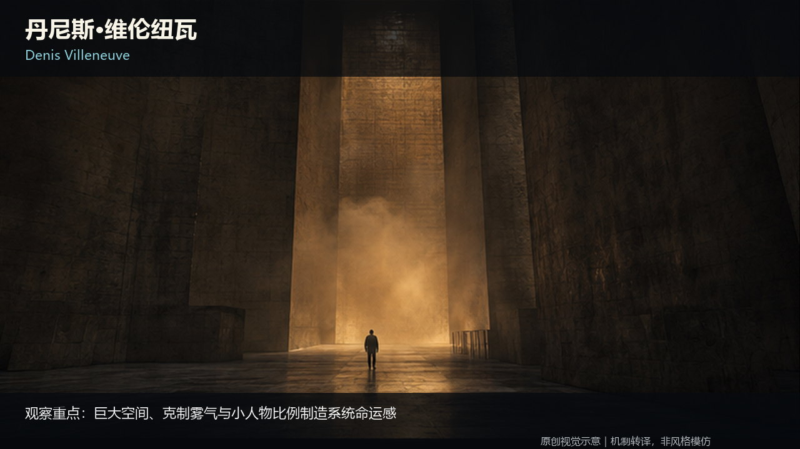
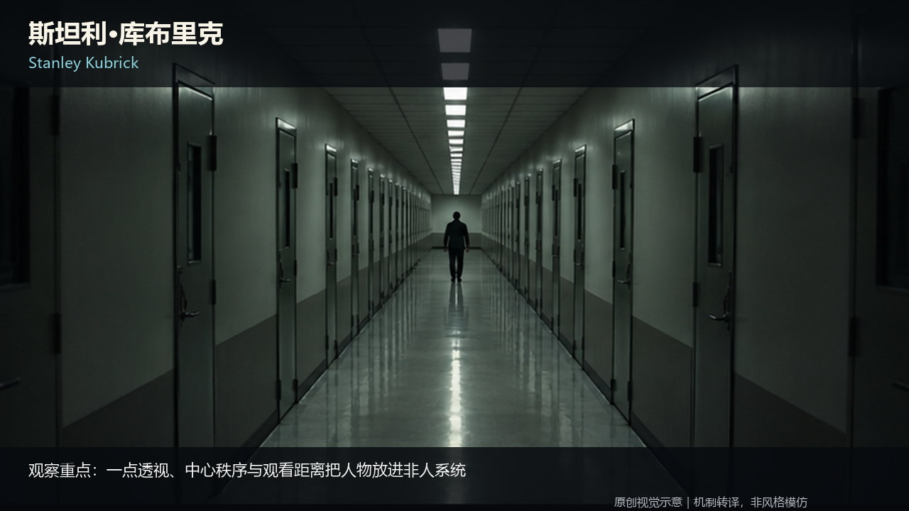
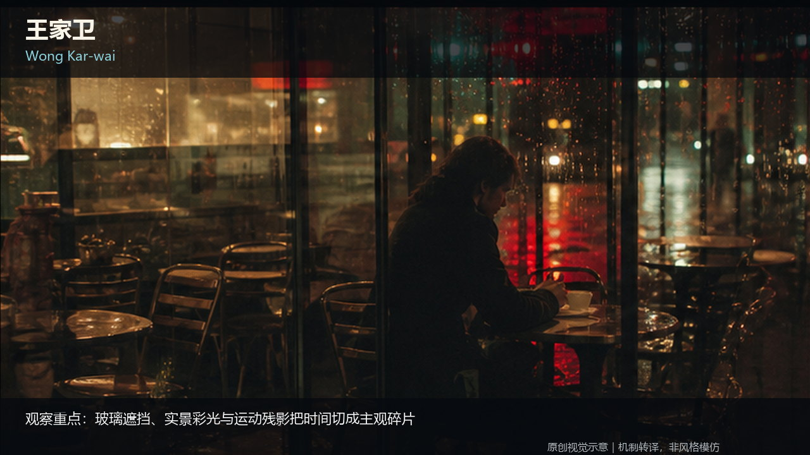
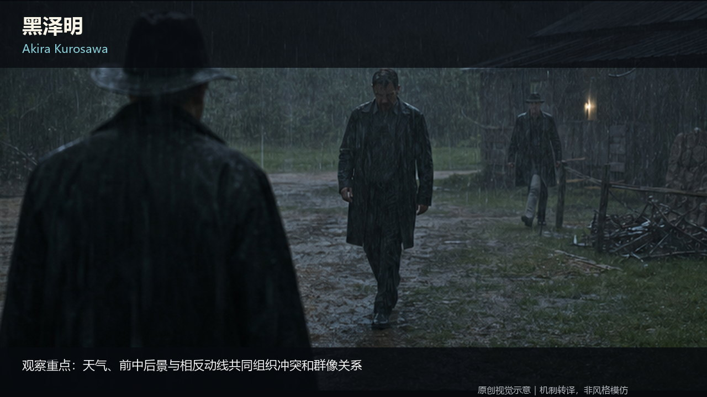
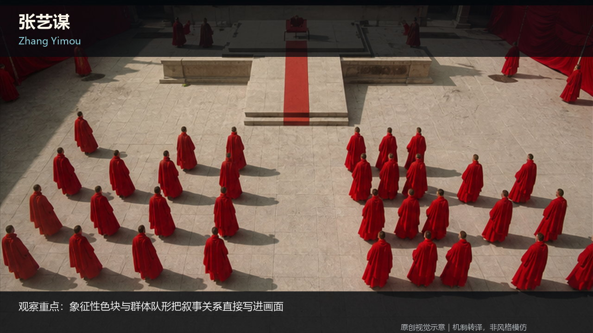

# AI Film Knowledge Base

**GitHubで1つのノートを直接読めます。索引をたどれば「理論 → 実践 → レビュー」の全体ルートになります。**

[English](../../../README.md) · [简体中文](../zh-CN/README.md) · **日本語** · [한국어](../ko/README.md)

## GitHubで直接読む

インストール、データベースへの取り込み、Obsidian、付属Skillは不要です。任意のMarkdownファイルをGitHubで開き、1件だけ利用することも、索引から全体をたどることもできます。

| A · 理論 | B · 実践 | C · レビューと受け入れ |
|---|---|---|
| 撮影、演出、脚本、映画言語の判断がなぜ機能するかを説明します。 | 判断を絵コンテ、プロンプト、ショット、動作、プラットフォーム実践へ変換します。 | 入力を固定し、結果を審査し、壊れた判断まで戻し、技術成功と正式採用を分けます。 |
| **51件** · [Aを開く](../../../knowledge/A-理论层/) | **43件** · [Bを開く](../../../knowledge/B-实战层/) | **7件** · [Cを開く](../../../knowledge/C-审核与验收层/) |

全件は [Catalog](../../../CATALOG.md)、公開ルールと総入口は [`00-总纲`](../../../knowledge/00-总纲/) を参照してください。

## 公開内容

公開版は合計 **105件のMarkdownノート**です。内訳は、公開総則4件、A理論51件、B実践43件、新規の公共Cレビュー7件です。

公共Cは、非公開のAIインフラ層や個人の振り返り・検証記録のコピーではありません。状態、証拠、範囲固定、原因に応じた差し戻し、AI映像の五段階審査、Skillの独立利用、知識と画像の公開判定だけを一般化しています。

[696 source images and 10 public method diagrams](../../VISUAL_ASSETS.md).

## 画像の公開

既存ノートの **696点の原画像**を公開し、**730か所**の本文内表示を復元しました。元の10点の説明SVGも残っています。旧版の候補・公開待ちという扱いは今回の公開で置き換えられました。図は映画の実フレームではなく、構図・演出・光・色を学ぶためのオリジナル教材です。

[Image gallery](../../IMAGE_GALLERY.md) · [Image manifest](../../IMAGE_MANIFEST.json)

## Agent、言語、フィードバック

本文の正本は簡体字中国語です。通常のMarkdownを読めるCodex、Claude Code、TRAE、CodeBuddy、WorkBuddy、その他のAgentで利用できますが、すべての製品に同一のネイティブ取り込み機能があるという意味ではありません。

実行可能なAgentワークフローは [Open Film Skills](https://github.com/62656456/ai-film-skills) を参照してください。知識ノート1件とSkill 1件は、それぞれ独立して利用できます。

フィードバック: [GitHub Discussions](https://github.com/62656456/ai-film-knowledge-base/discussions) · [GitHub Issues](https://github.com/62656456/ai-film-knowledge-base/issues) · [haldissita@gmail.com](mailto:haldissita@gmail.com)

表示構造は [OmniRoute](https://github.com/diegosouzapw/OmniRoute) を参考にしていますが、ブランド、画像、文章、コードは複製していません。

ライセンス: オリジナルの知識本文と登録済みの教材画像696点とSVG 10点は [CC BY 4.0](../../../LICENSE) です。外部リンク、引用、第三者素材の権利は含みません。

## Visual examples

### Stanley Kubrick

Geometry becomes pressure: a small figure, repeated lines and a rigid central axis make the space feel more powerful than the person.

### Wong Kar-wai

Occlusion, reflections and separated positions make an unfinished relationship visible before anyone explains it.

### Akira Kurosawa

Weather and group direction carry conflict. Read who faces where, which body moves first and how the group responds.

### Zhang Yimou

Color, repetition and collective formations turn an individual choice into a visible relationship with a larger order.

[Director library](../../../knowledge/A-%E7%90%86%E8%AE%BA%E5%B1%82/A2-%E5%AF%BC%E6%BC%94%E7%BB%84/A2-05%20%E5%AF%BC%E6%BC%94%E4%B8%8E%E6%91%84%E5%BD%B1%E6%8C%87%E5%AF%BC%E9%A3%8E%E6%A0%BC.md)
