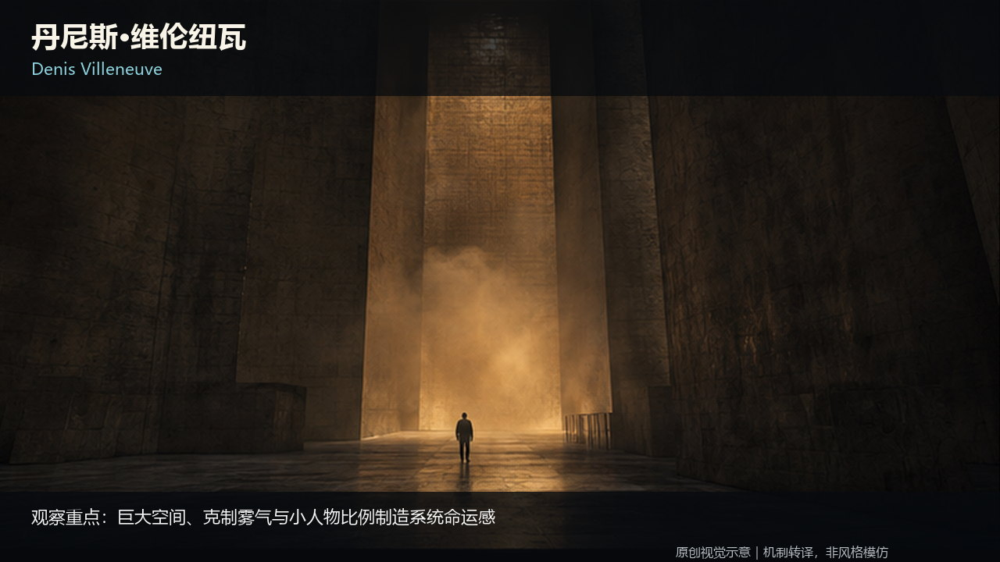
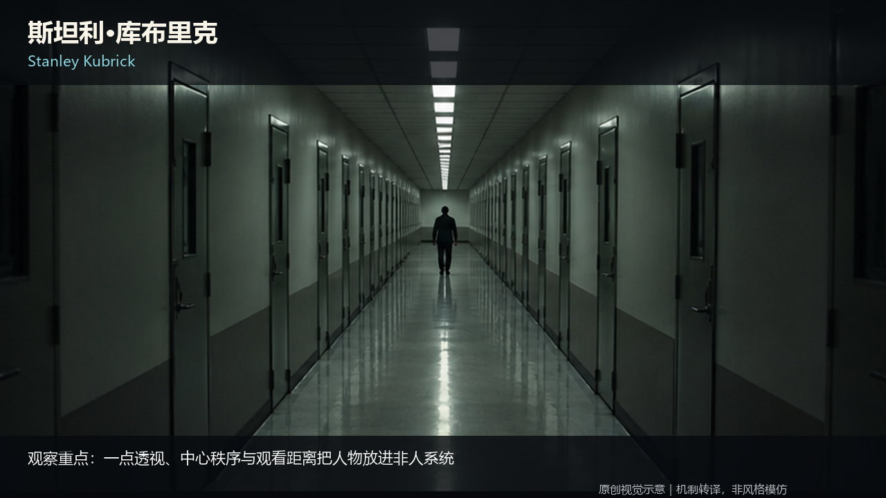
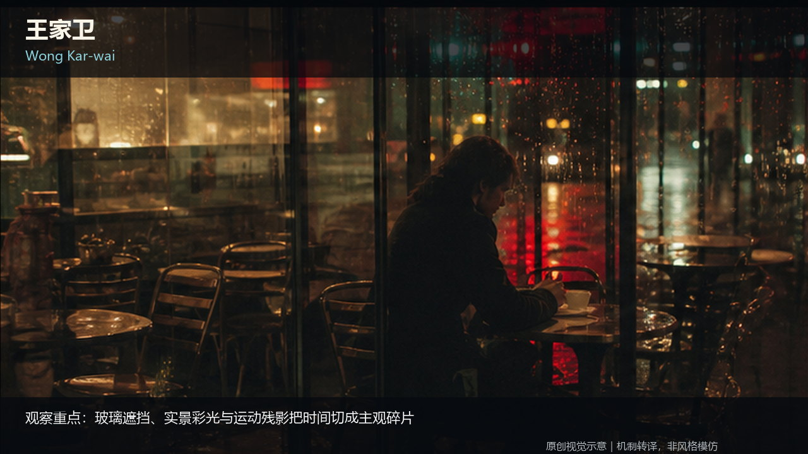
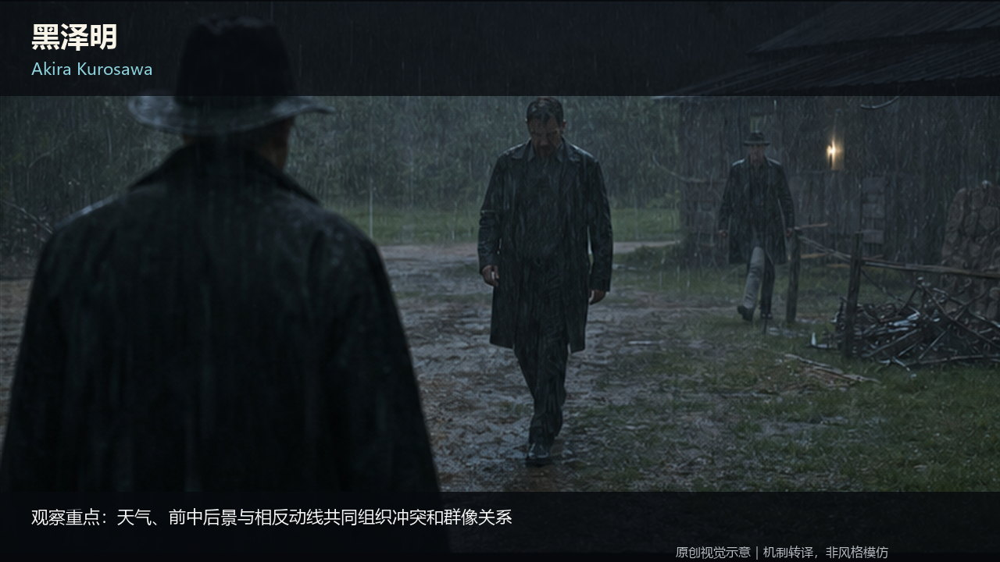
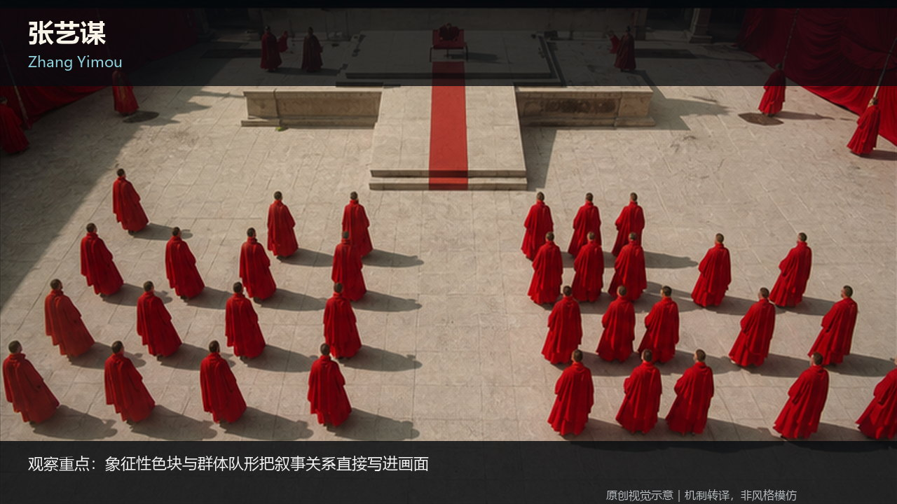

# AI Film Knowledge Base

**GitHub에서 노트 한 편을 바로 읽거나, 색인을 따라 ‘이론 → 실전 → 검토’ 전체 경로를 사용할 수 있습니다.**

[English](../../../README.md) · [简体中文](../zh-CN/README.md) · [日本語](../ja/README.md) · **한국어**

## GitHub에서 바로 읽기

설치, 데이터베이스 가져오기, Obsidian, 동반 Skill이 필요하지 않습니다. GitHub의 일반 파일 화면에서 원하는 Markdown 한 편만 열어도 되고, 색인을 따라 전체 체계를 읽어도 됩니다.

| A · 이론 | B · 실전 | C · 검토와 승인 |
|---|---|---|
| 촬영, 연출, 시나리오, 영화 언어의 판단이 왜 작동하는지 설명합니다. | 판단을 스토리보드, 프롬프트, 쇼트, 액션, 플랫폼 워크플로로 바꿉니다. | 입력을 고정하고 결과를 심사하며, 실패한 결정으로 되돌리고 기술 성공과 실제 승인을 구분합니다. |
| **51편** · [A 열기](../../../knowledge/A-理论层/) | **43편** · [B 열기](../../../knowledge/B-实战层/) | **7편** · [C 열기](../../../knowledge/C-审核与验收层/) |

전체 목록은 [Catalog](../../../CATALOG.md), 공개 규칙과 시작점은 [`00-总纲`](../../../knowledge/00-总纲/)을 확인하세요.

## 공개 콘텐츠

공개판은 총 **105개의 Markdown 노트**를 포함합니다. 공개 총칙 4편, A 이론 51편, B 실전 43편, 새로 작성한 공용 C 검토·승인 노트 7편입니다.

공용 C는 비공개 AI 인프라 계층이나 개인 회고·검증 기록을 복사한 것이 아닙니다. 상태, 증거, 범위 고정, 원인에 따른 되돌림, AI 영상 5단계 검토, Skill 독립 사용, 지식과 이미지 공개 게이트만 일반화합니다.

[696 source images and 10 public method diagrams](../../VISUAL_ASSETS.md).

## 이미지 공개

기존 노트에 사용된 **696개 원본 이미지**를 공개하고 본문 **730곳**의 이미지를 복원했습니다. 기존 설명 SVG 10개도 유지합니다. 이전의 후보·공개 대기 상태는 이번 공개로 대체되었습니다. 이미지는 영화의 실제 프레임이 아닌 구도·연출·빛·색을 설명하는 창작 교육 자료입니다.

[Image gallery](../../IMAGE_GALLERY.md) · [Image manifest](../../IMAGE_MANIFEST.json)

## Agent, 언어, 피드백

본문의 기준 언어는 중국어 간체입니다. 일반 Markdown을 읽을 수 있는 Codex, Claude Code, TRAE, CodeBuddy, WorkBuddy 및 기타 Agent에서 사용할 수 있지만, 모든 제품에 동일한 기본 가져오기 기능이 있다는 뜻은 아닙니다.

실행 가능한 Agent 워크플로는 [Open Film Skills](https://github.com/62656456/ai-film-skills)를 확인하세요. 지식 노트 한 편과 Skill 하나는 각각 독립적으로 사용할 수 있습니다.

피드백: [GitHub Discussions](https://github.com/62656456/ai-film-knowledge-base/discussions) · [GitHub Issues](https://github.com/62656456/ai-film-knowledge-base/issues) · [haldissita@gmail.com](mailto:haldissita@gmail.com)

표현 구조는 [OmniRoute](https://github.com/diegosouzapw/OmniRoute)를 참고했지만 브랜드, 이미지, 문구, 코드는 복제하지 않았습니다.

라이선스: 오리지널 지식 본문과 등록된 교육 이미지 696개와 SVG 10개는 [CC BY 4.0](../../../LICENSE)입니다. 외부 링크, 인용, 제3자 자료의 권리는 포함하지 않습니다.

## Visual examples

### Stanley Kubrick

Geometry becomes pressure: a small figure, repeated lines and a rigid central axis make the space feel more powerful than the person.

### Wong Kar-wai

Occlusion, reflections and separated positions make an unfinished relationship visible before anyone explains it.

### Akira Kurosawa

Weather and group direction carry conflict. Read who faces where, which body moves first and how the group responds.

### Zhang Yimou

Color, repetition and collective formations turn an individual choice into a visible relationship with a larger order.

[Director library](../../../knowledge/A-%E7%90%86%E8%AE%BA%E5%B1%82/A2-%E5%AF%BC%E6%BC%94%E7%BB%84/A2-05%20%E5%AF%BC%E6%BC%94%E4%B8%8E%E6%91%84%E5%BD%B1%E6%8C%87%E5%AF%BC%E9%A3%8E%E6%A0%BC.md)
