# AI影视知识库 · 导演的图像与方法

**从一张画面看懂一个选择，再把它带进自己的创作。**

[English](../../../README.md) · **简体中文** · [日本語](../ja/README.md) · [한국어](../ko/README.md)

摄影、导演、编剧、分镜、提示词与审核组成一个互相连接的知识体系。可以只读一篇，也可以沿着作品机制一路走到制作与检查。

**105 篇知识笔记 · 696 张公开原图 · 730 处正文配图 · 10 张公共方法图**

[看全部图片](../../../docs/IMAGE_GALLERY.md) · [阅读完整目录](../../../CATALOG.md) · [进入导演案例库](../../../knowledge/A-%E7%90%86%E8%AE%BA%E5%B1%82/A2-%E5%AF%BC%E6%BC%94%E7%BB%84/A2-05%20%E5%AF%BC%E6%BC%94%E4%B8%8E%E6%91%84%E5%BD%B1%E6%8C%87%E5%AF%BC%E9%A3%8E%E6%A0%BC.md)

[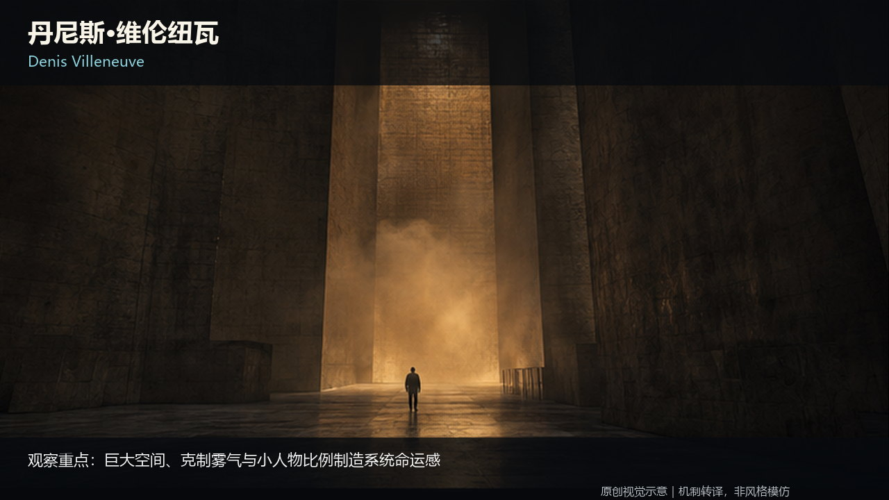 ](../../../knowledge/A-%E7%90%86%E8%AE%BA%E5%B1%82/A2-%E5%AF%BC%E6%BC%94%E7%BB%84/A2-05%20%E5%AF%BC%E6%BC%94%E4%B8%8E%E6%91%84%E5%BD%B1%E6%8C%87%E5%AF%BC%E9%A3%8E%E6%A0%BC.md)

**先看这一张。** 人物只占很小的画面面积，竖向建筑线条把视线收束到背光中的人。空间、比例和光线已经在表达压力。继续读[导演与摄影指导风格](../../../knowledge/A-%E7%90%86%E8%AE%BA%E5%B1%82/A2-%E5%AF%BC%E6%BC%94%E7%BB%84/A2-05%20%E5%AF%BC%E6%BC%94%E4%B8%8E%E6%91%84%E5%BD%B1%E6%8C%87%E5%AF%BC%E9%A3%8E%E6%A0%BC.md)，把这种观察连到具体作品、协作关系与适用条件。

## 看导演怎样组织画面

下面是已有知识卡中的原创机制示意，**不是所列导演作品的电影截图**。姓名帮助定位研究方向，具体创作仍要拆成构图、站位、光源、时间和声音。

| **斯坦利·库布里克** | **王家卫** |
|---|---|
| [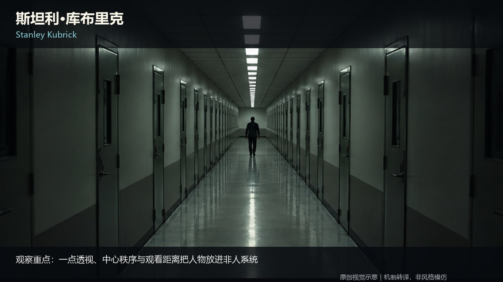](../../../knowledge/A-%E7%90%86%E8%AE%BA%E5%B1%82/A2-%E5%AF%BC%E6%BC%94%E7%BB%84/A2-05%20%E5%AF%BC%E6%BC%94%E4%B8%8E%E6%91%84%E5%BD%B1%E6%8C%87%E5%AF%BC%E9%A3%8E%E6%A0%BC.md) | [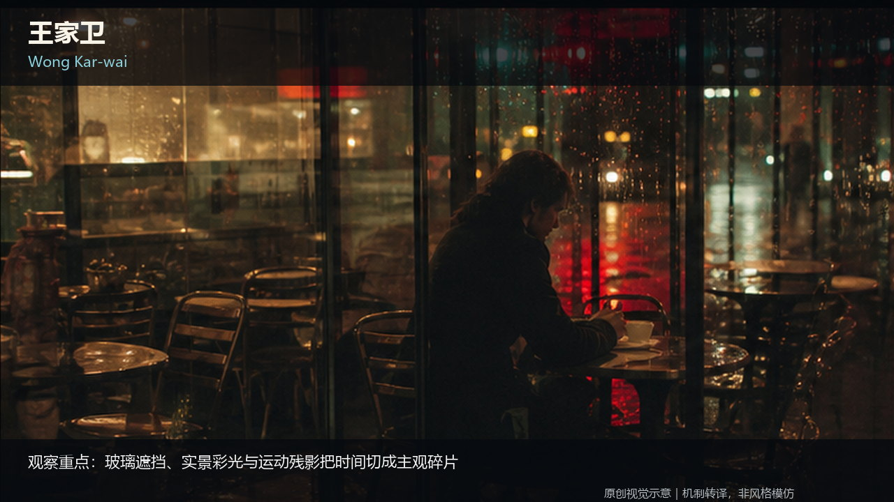](../../../knowledge/A-%E7%90%86%E8%AE%BA%E5%B1%82/A2-%E5%AF%BC%E6%BC%94%E7%BB%84/A2-05%20%E5%AF%BC%E6%BC%94%E4%B8%8E%E6%91%84%E5%BD%B1%E6%8C%87%E5%AF%BC%E9%A3%8E%E6%A0%BC.md) |
| 几何秩序形成压力：小人物、重复线条与居中轴线，让空间的控制感压过人物。 | 用遮挡、反射与人物错位，把没说出口的关系放进画面；色彩与时间处理跟随这层关系。 |

| **黑泽明** | **张艺谋** |
|---|---|
| [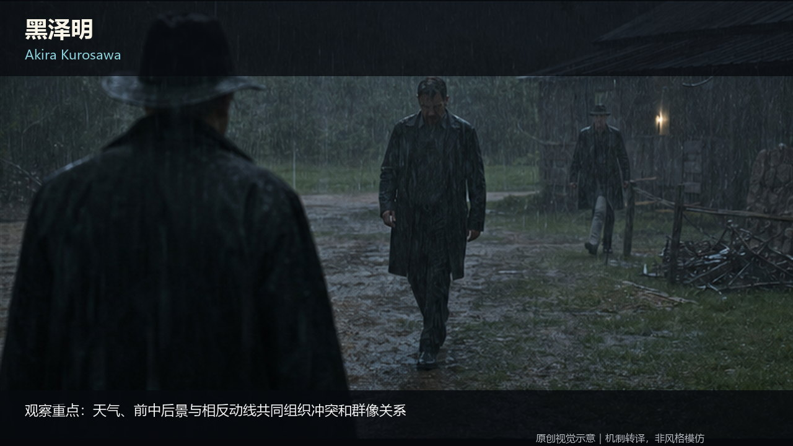](../../../knowledge/A-%E7%90%86%E8%AE%BA%E5%B1%82/A2-%E5%AF%BC%E6%BC%94%E7%BB%84/A2-05%20%E5%AF%BC%E6%BC%94%E4%B8%8E%E6%91%84%E5%BD%B1%E6%8C%87%E5%AF%BC%E9%A3%8E%E6%A0%BC.md) | [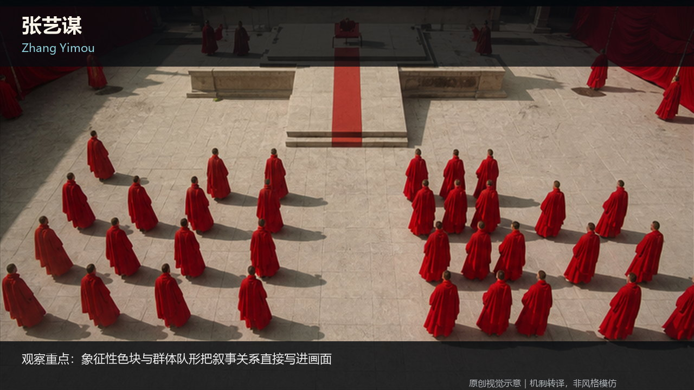](../../../knowledge/A-%E7%90%86%E8%AE%BA%E5%B1%82/A2-%E5%AF%BC%E6%BC%94%E7%BB%84/A2-05%20%E5%AF%BC%E6%BC%94%E4%B8%8E%E6%91%84%E5%BD%B1%E6%8C%87%E5%AF%BC%E9%A3%8E%E6%A0%BC.md) |
| 让天气与群体方向参与冲突：看谁朝向哪里、谁先动、其他人的重心和队形怎样回应。 | 把色彩、重复和群体阵列放在一起，看个人选择怎样与更大的秩序发生关系。 |

| **史蒂文·斯皮尔伯格** | **大卫·芬奇** |
|---|---|
| [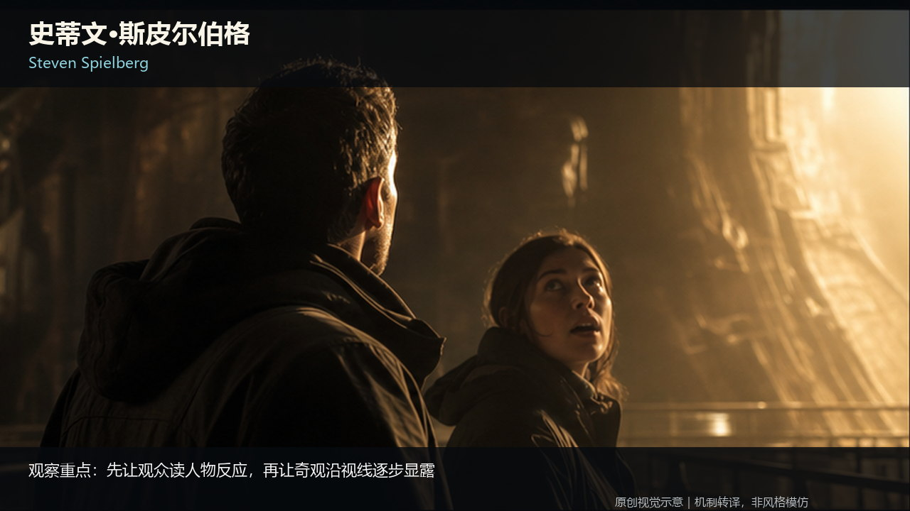](../../../knowledge/A-%E7%90%86%E8%AE%BA%E5%B1%82/A2-%E5%AF%BC%E6%BC%94%E7%BB%84/A2-05%20%E5%AF%BC%E6%BC%94%E4%B8%8E%E6%91%84%E5%BD%B1%E6%8C%87%E5%AF%BC%E9%A3%8E%E6%A0%BC.md) | [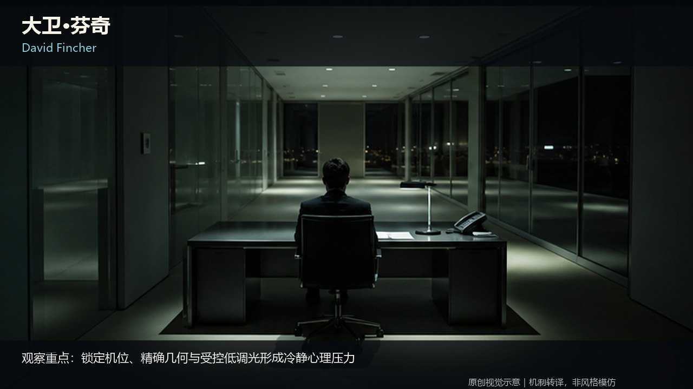](../../../knowledge/A-%E7%90%86%E8%AE%BA%E5%B1%82/A2-%E5%AF%BC%E6%BC%94%E7%BB%84/A2-05%20%E5%AF%BC%E6%BC%94%E4%B8%8E%E6%91%84%E5%BD%B1%E6%8C%87%E5%AF%BC%E9%A3%8E%E6%A0%BC.md) |
| 人物的反应与视线为揭示作准备：观众跟着角色发现事件，信息按观看过程逐步展开。 | 用受控构图与克制光线组织注意力，让未揭示的信息和人物之间的压力留在画面里。 |

读完整卡片：[21 位导演／摄影指导速查与 15 条深度案例](../../../knowledge/A-%E7%90%86%E8%AE%BA%E5%B1%82/A2-%E5%AF%BC%E6%BC%94%E7%BB%84/A2-05%20%E5%AF%BC%E6%BC%94%E4%B8%8E%E6%91%84%E5%BD%B1%E6%8C%87%E5%AF%BC%E9%A3%8E%E6%A0%BC.md)。

## 把看图变成可用的判断

### 景别：让观众靠近什么

[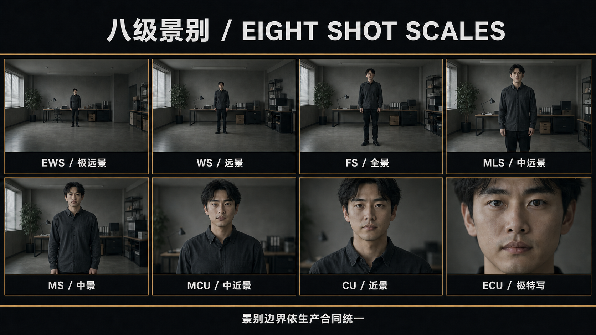](../../../knowledge/A-%E7%90%86%E8%AE%BA%E5%B1%82/A1-%E6%91%84%E5%BD%B1%E7%BB%84/A1-01%20%E6%99%AF%E5%88%AB%E7%B3%BB%E7%BB%9F.md)

从环境关系到表情和细节，景别改变的是观众此刻得到的信息。对照同一个人物的画面占比，再读各级景别的用途与边界。 [阅读图文讲解](../../../knowledge/A-%E7%90%86%E8%AE%BA%E5%B1%82/A1-%E6%91%84%E5%BD%B1%E7%BB%84/A1-01%20%E6%99%AF%E5%88%AB%E7%B3%BB%E7%BB%9F.md)。

### 调度：让关系发生变化

[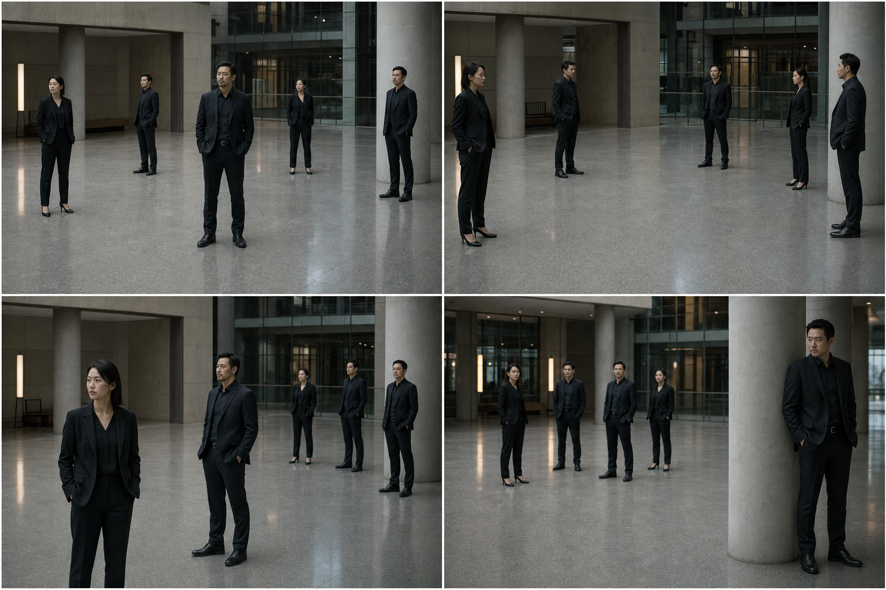](../../../knowledge/A-%E7%90%86%E8%AE%BA%E5%B1%82/A2-%E5%AF%BC%E6%BC%94%E7%BB%84/A2-01%20%E8%B0%83%E5%BA%A6%E4%B8%8E%E5%9C%BA%E9%9D%A2%E8%B0%83%E5%BA%A6.md)

人物站位、朝向、距离和重心是一套关系。看谁占据中心、谁被隔开，以及一次移动怎样改变整组人的力量分布。 [阅读图文讲解](../../../knowledge/A-%E7%90%86%E8%AE%BA%E5%B1%82/A2-%E5%AF%BC%E6%BC%94%E7%BB%84/A2-01%20%E8%B0%83%E5%BA%A6%E4%B8%8E%E5%9C%BA%E9%9D%A2%E8%B0%83%E5%BA%A6.md)。

### 视觉风格：在相同条件下看差异

[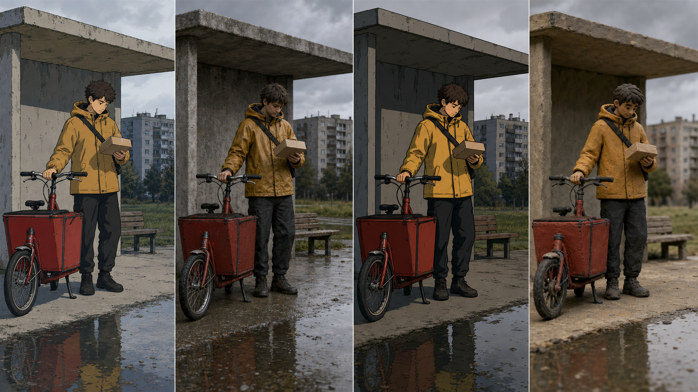](../../../knowledge/A-%E7%90%86%E8%AE%BA%E5%B1%82/A2-%E5%AF%BC%E6%BC%94%E7%BB%84/A2-07%20%E7%94%B5%E5%BD%B1%E8%A7%86%E8%A7%89%E9%A3%8E%E6%A0%BC%E5%9D%90%E6%A0%87%E7%B3%BB%E4%B8%8E%E6%9C%AF%E8%AF%AD%E6%80%BB%E7%BA%B2.md)

保持人物、姿态与基本构图，观察平涂、水彩、三维或实体媒介怎样改变线条、体积、材质和光。图鉴把风格词转成能看见的选择。 [阅读图文讲解](../../../knowledge/A-%E7%90%86%E8%AE%BA%E5%B1%82/A2-%E5%AF%BC%E6%BC%94%E7%BB%84/A2-07%20%E7%94%B5%E5%BD%B1%E8%A7%86%E8%A7%89%E9%A3%8E%E6%A0%BC%E5%9D%90%E6%A0%87%E7%B3%BB%E4%B8%8E%E6%9C%AF%E8%AF%AD%E6%80%BB%E7%BA%B2.md)。

## 按你的创作问题进入

| 当前问题 | 入口 | 篇数 |
|---|---|---:|
| 画面为什么成立？ | [A · 理论 / Theory](../../../knowledge/A-%E7%90%86%E8%AE%BA%E5%B1%82/) | 51 |
| 怎样把它做出来？ | [B · 实战 / Practice](../../../knowledge/B-%E5%AE%9E%E6%88%98%E5%B1%82/) | 43 |
| 做完之后检查什么？ | [C · 审核 / Review](../../../knowledge/C-%E5%AE%A1%E6%A0%B8%E4%B8%8E%E9%AA%8C%E6%94%B6%E5%B1%82/) | 7 |

另有 4 篇总纲，共 **105 篇 Markdown 知识笔记**。无需安装软件；在 GitHub 打开任意知识卡即可阅读。图片原件可以直接浏览、下载，也可以从[逐图清单](../../../docs/IMAGE_MANIFEST.json)查文件、尺寸、许可、哈希和出现位置。

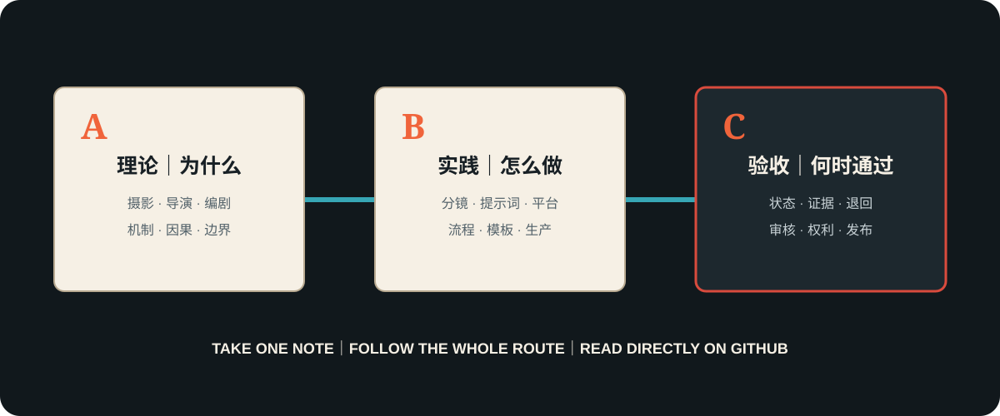

## 给读者，也给创作工具

知识正文以简体中文为准，入口提供四种语言。普通 Markdown 可由人直接阅读，也可按任务交给能读取文件的 Agent。配套[Open Film Skills](https://github.com/62656456/ai-film-skills)提供编剧、导演、分镜等执行方法；每篇知识和每个 Skill 都可单独使用。

## 公开、许可与参与

本次将现有公开知识卡使用的 **696 张源图全部公开**，恢复 **730 处正文引用**；另保留 10 张公共方法 SVG。此前“622 张候选／上传 0 张”的等待授权说明已被本次发布取代。教学图不能反向证明真实电影拍摄参数或动态效果，真人物与作品事实仍以正文来源为准。

原创正文与登记的原创教学图使用 [CC BY 4.0](../../../LICENSE)；引用和外链作品保留原作者权利。见[发布范围](../../../PUBLICATION_SCOPE.md)与[视觉登记](../../../docs/VISUAL_ASSETS.md)。

[Contributing](../../../CONTRIBUTING.md) · [Issues](https://github.com/62656456/ai-film-knowledge-base/issues) · [Discussions](https://github.com/62656456/ai-film-knowledge-base/discussions) · [haldissita@gmail.com](mailto:haldissita@gmail.com)
